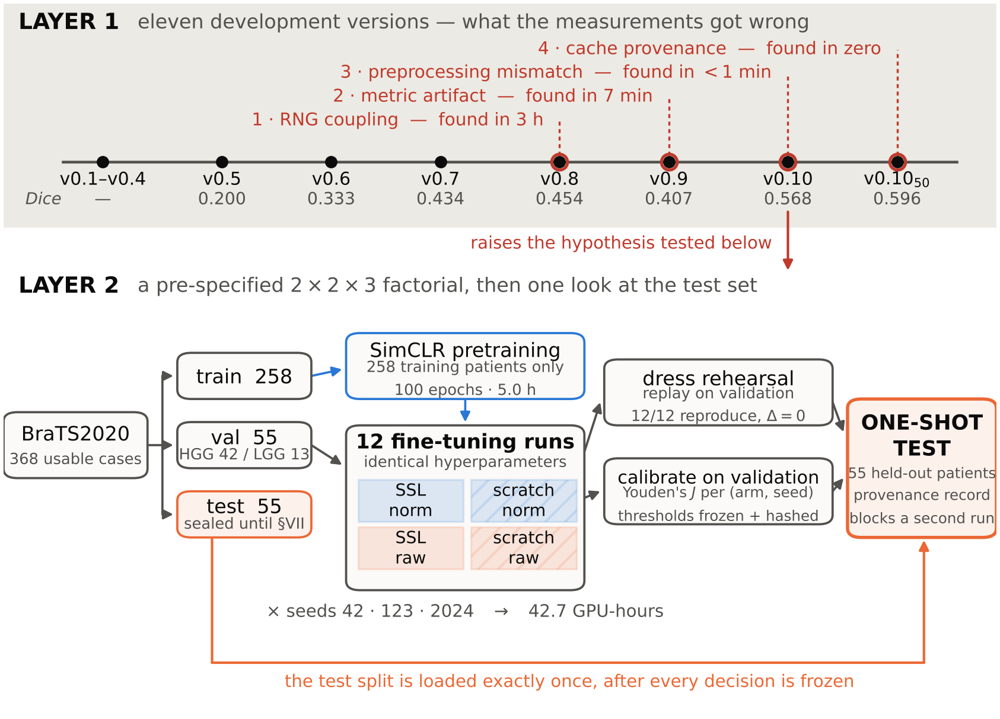
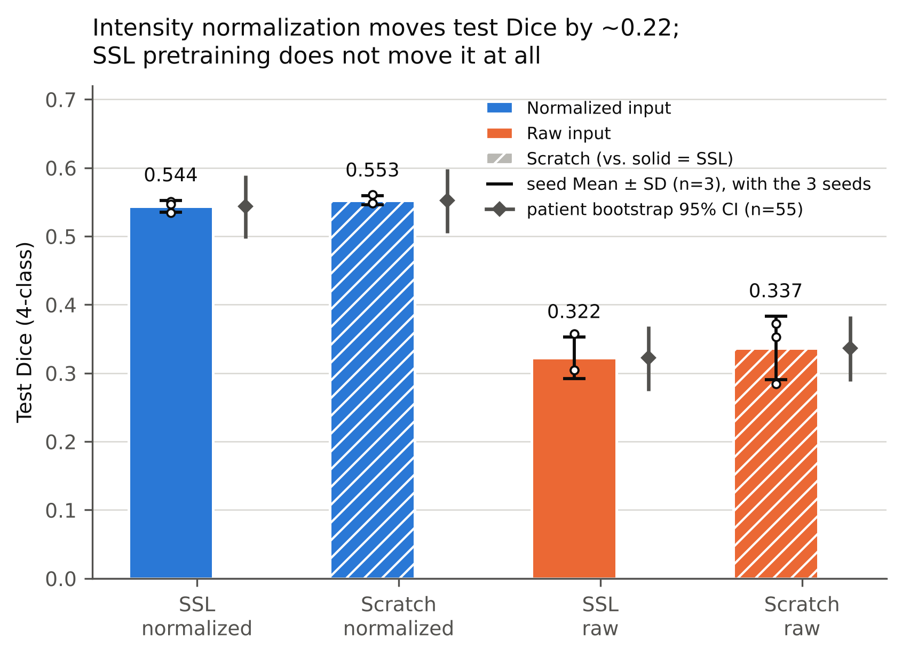
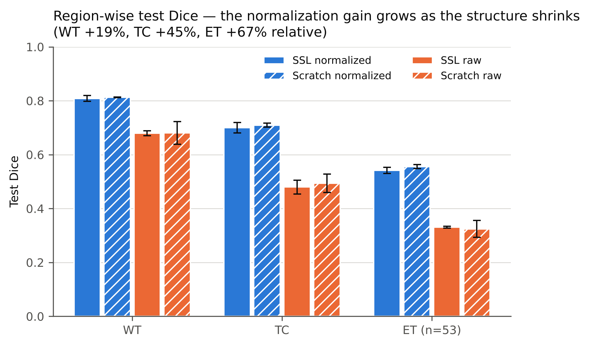
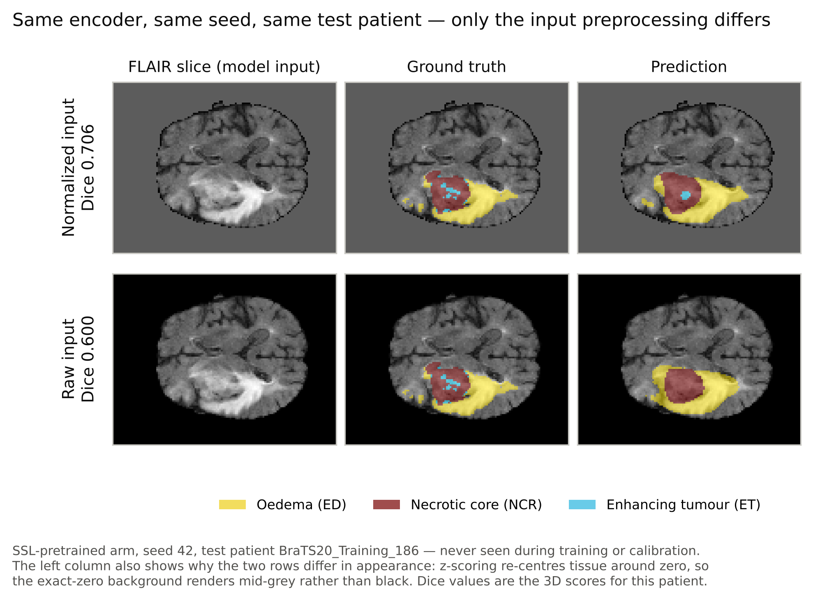
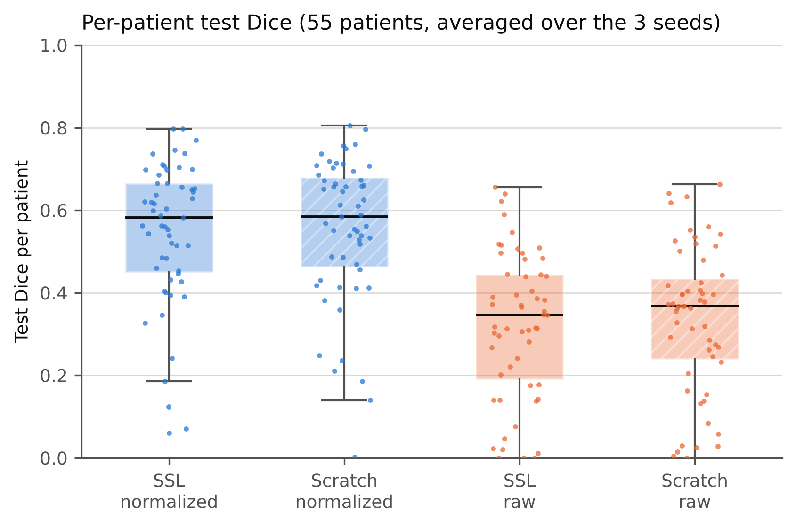
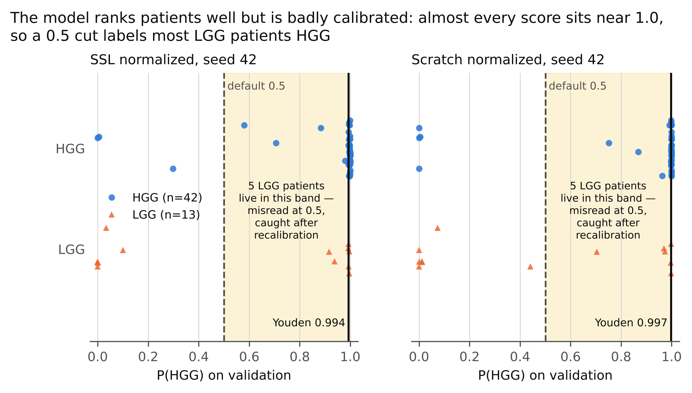

# MedSSL-3D

Code, run records and frozen results for:

> **Measure First, Train Second: Four Failure Modes and a Controlled Factorial Study of
> Preprocessing versus Self-Supervised Pretraining in 3D Brain Tumour Segmentation**
> Ilia Aghajanzadeh, Majid Sepahvand — Department of Computer Engineering, Arak University

A 3D multi-task model (4-class tumour segmentation + HGG/LGG classification) on BraTS 2020,
trained end to end on a single 6 GB laptop GPU (RTX 3050 Laptop). The study has two layers:

- **Layer 1:** eleven development versions (v0.1 → v0.10) and four methodological defects
  found along the way: an RNG/batch-order coupling, a metric artifact, a preprocessing
  mismatch, and a cache-provenance error. For each one the paper reports how it was found,
  what finding it cost, and what it changed.
- **Layer 2:** a pre-specified 2 × 2 × 3 factorial with {SimCLR-pretrained, scratch} ×
  {per-patient intensity normalization, raw} × {seeds 42, 123, 2024} = 12 fine-tuning runs,
  all with identical hyperparameters. The 55-patient test split was evaluated exactly once.

<p align="center">
  
</p>

**Headline result:** on the held-out test set, per-patient intensity normalization raised
mean Dice by about **+0.22**, with non-overlapping patient-bootstrap 95% CIs. It improved
54 of 55 test patients (SSL arms) and 52 of 55 (scratch arms). 100 epochs of SimCLR
pretraining on the 258 training volumes produced **no measurable benefit** at this scale.

| arm | test Dice (seed mean ± SD, n = 3) | bootstrap 95% CI (n = 55) |
|---|---|---|
| `ssl_norm` | 0.5439 ± 0.0084 | [0.4967, 0.5893] |
| `ssl_raw` | 0.3221 ± 0.0304 | [0.2739, 0.3684] |
| `scratch_norm` | 0.5526 ± 0.0069 | [0.5046, 0.5979] |
| `scratch_raw` | 0.3366 ± 0.0463 | [0.2884, 0.3835] |

<p align="center">
  
</p>

The same pattern holds in every tumour region. The relative gain from normalization grows
as the structure gets smaller: whole tumour +19%, tumour core +45%, enhancing tumour +67%.
One test patient, same encoder and seed, with only the input preprocessing changed:

<p align="center">
  
  
</p>

<details>
<summary><b>More figures</b>: per-patient distributions and threshold calibration</summary>

<p align="center">
  
</p>
<p align="center">
  
</p>
</details>

Every number in the paper can be recomputed from the files in `results/`. See
[Verify the paper's numbers](#verify-the-papers-numbers).

---

## Repository layout

```
notebooks/                  the runs that produced the paper's numbers (outputs kept)
  v0_11_partA_simclr_pretrain_100ep.ipynb      SimCLR pretraining, train split only
  v0_11_partB_factorial_seed{42,123,2024}.ipynb  the 12 fine-tuning runs, one round per seed
  v0_11_partC_rescore_and_threshold_freeze.ipynb validation re-scoring + frozen thresholds
  v0_11_partD_test_one_shot.ipynb              the single test-set evaluation
  smoke_and_rehearsal/      the short smoke runs and the full test dress rehearsal
history/                    development versions v0.1 – v0.10 (Layer 1 evidence)
results/                    frozen result CSVs + JSON provenance records
  runs/                     per-epoch training history for each of the 12 runs
  ssl_pretrain/             SimCLR loss history + provenance
  development/              result logs of v0.7 – v0.10, the numbers behind Layer 1
data/split_v1_patient_ids.json   the fixed 258 / 55 / 55 patient split (IDs only)
paper/                      verify.py and the figure scripts
tools/make_split_file.py    rebuilds the split file the notebooks load
tools/check_hashes.py       checks every file against its recorded SHA-256
environment/                full export of the training environment (Windows, conda)
docs/figures/               the paper's figures, as produced by the scripts in paper/
```

Each notebook is a single self-contained cell: later versions carry all earlier code forward
unchanged and add new sections (marked `# NEW in vX.Y`). Every smoke or rehearsal notebook
has the **same source as its real run except one flag line**:

| part | flag | smoke / rehearsal | real run |
|---|---|---|---|
| A | `Config.SSL_V2_SMOKE_TEST` | `True` | `False` |
| B | `Config.V2_FACTORIAL_SMOKE_TEST` | `True` | `False` (`V2_FACTORIAL_SEED` set per round) |
| C | `Config.V2_RESCORE_SMOKE_TEST` | `True` | `False` |
| D | `Config.V2_TEST_DRESS_REHEARSAL` | `True` | `False` |

Every file copied from the project is **byte-identical to the original**, notebook outputs
included. `tools/MANIFEST.sha256` lists the SHA-256 of each one. The code is published
exactly as it was run, so it is the code that produced the reported numbers. It keeps the
author's local paths (see Setup, step 3).

## Setup

1. **Environment.** Python 3.10 with PyTorch 2.7.1 (CUDA 11.8):
   ```bash
   pip install torch==2.7.1 --index-url https://download.pytorch.org/whl/cu118
   pip install -r requirements.txt
   ```
   `environment/` holds the full, frozen export of the original Windows conda environment.
2. **Data.** BraTS 2020 cannot be redistributed. Obtain the
   *MICCAI_BraTS2020_TrainingData* release (369 studies; one has no mask, leaving 368
   usable) from the official BraTS 2020 / CBICA source. It must include `name_mapping.csv`,
   which provides the HGG/LGG labels.
3. **Paths.** Edit the path lines in the notebook's `Config`: `DATA_ROOT`, `DESKTOP_BASE`,
   and, for v0.11, `Config.V2_ROOT`. The easiest option is to mirror the original layout
   under `D:/MedSSL/`.
4. **Split.** Rebuild the exact patient split the notebooks load. They never recompute it:
   ```bash
   python tools/make_split_file.py \
       --brats-root "D:/MedSSL/MICCAI_BraTS2020_TrainingData" \
       --out        "D:/MedSSL/MedSSL_Results/data_split_v1.json"
   ```
   The script checks the training-ID hash
   (`f84bfa95…40aa7`) and preserves the original patient order.

## Reproducing the experiment

Run the four v0.11 notebooks in order (A → B ×3 → C → D). On the original hardware this
took 5.0 h for pretraining, 42.7 h for the twelve fine-tuning runs, and under 1 h for
re-scoring and testing.

| step | writes | used for |
|---|---|---|
| A | `ssl_pretrain/encoder_v2_trainonly_4ch_ep100.pth`, `provenance.json` | the SSL encoder |
| B | 12 checkpoints, `v0_11_factorial_summary.csv`, `runs/*_history.csv` | validation Dice, factorial contrasts |
| C | `v0_11_val_scores.csv`, `v0_11_classification_report.csv`, `v0_11_thresholds_frozen.json` | classification, calibrated thresholds |
| D | `v0_11_test_report.csv`, `v0_11_test_per_patient.csv`, `v0_11_test_provenance.json` | every test-set number |

Part D runs a full dress rehearsal on validation first. In the original run it reproduced
all 12 stored runs with Δ = 0 on Dice and identical confusion matrices. Only then is the
test set opened, once. A provenance file acts as a one-shot guard against running it again.
The original evaluation's record is in `results/v0_11_test_provenance.json`.

## Verify the paper's numbers

No GPU and no data are needed:

```bash
python tools/check_hashes.py .      # expect: ALL CHECKS PASSED
python paper/verify.py results      # expect: 66 + 76 checks pass, 0 fail
python paper/verify_extra.py results   # paired Wilcoxon tests and the per-patient losses
```

`check_hashes.py` compares four result files with the SHA-256 values the pipeline wrote into
its own provenance records at run time. It also checks every copied file against the
publication manifest.

`verify.py` recomputes every reported statistic from the frozen CSVs. Standard deviations
use ddof = 1 with n = 3 seeds. Bootstrap CIs use 10,000 patient resamples. Figures:

```bash
cd paper && MEDSSL_CSV_DIR=../results python make_figs.py   # F2–F5
python make_fig_pipeline.py                                    # F1
python make_fig_qualitative.py                                 # F6 (uses the two overlay PNGs)
```

## Not included

- **BraTS images**: licence terms; see Setup step 2.
- **Model weights**: the 12 fine-tuned checkpoints and the SSL encoder total about 2.1 GB.
  The paper's claims are comparative, and the per-patient CSVs are enough to check every
  reported number.

## Scope of the claims

The SSL result is narrow: *at this scale (258 training volumes, 128 × 128 × 64 input), with
this pretext task, no benefit was measurable*. It is not a claim that self-supervision does
not work. Absolute Dice is limited by the low input resolution. The study is a controlled
comparison, not a leaderboard entry.

## License

Code: MIT (see `LICENSE`). BraTS 2020 data remain under their own terms.
